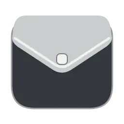

# lomme

**A simple, Mac-like archive utility for Windows — calm, clean, and easy to use.**

ZIP / 7Z / RAR · Windows 11 · 8 languages

[**Releases**](https://github.com/so1fr1d/lomme/releases)

---

## Meet lomme

A compact archive utility with a native Windows interface, light and dark themes, and familiar File Explorer integration.

<!-- Final image placement: assets/main-light-dark.webp -->

| Format | Create | Extract |
| :--- | :---: | :---: |
| ZIP | Yes | Yes |
| 7Z | Yes | Yes |
| RAR | No | Yes |

## Built for everyday archives

- Create ZIP and 7Z archives, and open or extract ZIP, 7Z, and RAR archives.
- **Open with lomme**, **Extract here**, and **Compress with lomme** from File Explorer's **Show more options** menu on Windows 11.
- Eight interface languages: Korean, English, Japanese, Simplified Chinese, Traditional Chinese, French, Spanish, and German.
- Password-protected ZIP and 7Z archives, with format-specific restrictions.

<!-- Final image placement: assets/archive-window.webp and assets/languages.webp -->
<!-- Final animation placement: assets/extract-demo.gif -->

## Download

**The first public release, v1.0.0, is in preparation.** Once available, download the installer from [GitHub Releases](https://github.com/so1fr1d/lomme/releases).

The installer is intended for Windows 11 x64, installs for the current Windows user, and does not automatically change default applications. Choose lomme as the default app for `.zip`, `.7z`, and `.rar` in **Windows Settings → Apps → Default apps**, if desired.

When lomme is the default app, double-clicking a supported archive extracts it. To inspect the contents first, choose **Open with lomme**.

## Good to know

- RAR archives can be read and extracted but not created.
- Use ASCII-only passwords for ZIP creation; 7Z passwords support Unicode.
- Changes to files opened temporarily from an archive are not automatically written back into the archive.
- Windows 11 x64 is the tested platform; Windows 10 is not verified.
- The first installer is expected to be **unsigned**.
- The 1.0 installer is not an in-place upgrade path for previous 0.4.x installations.

## Uninstall

Open **Windows Settings → Apps → Installed apps** and uninstall lomme. This removes lomme's settings, but not your own archive files, even if lomme is still your default archive app.

## Credits and licenses

**lomme** by **so1fr1d**.

Uses third-party components including 7-Zip 26.04 and Pretendard 1.3.9. Their licenses and applicable source-availability materials will be included in the release package. lomme's own distribution terms will be published with the first release.
