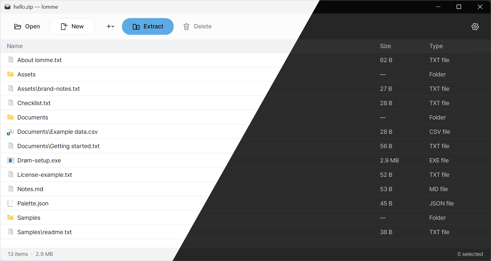

# lomme

**A simple, Mac-like archive utility for Windows — calm, clean, and easy to use.**

Windows 11 · ZIP / 7Z / RAR · Eight languages

[**Download (coming soon)**](https://github.com/so1fr1d/lomme/releases) · [Features](#features) · [Installation](#installation)

  

## Meet lomme

A small native Windows archive utility, with a familiar interface for browsing, creating, and extracting archives. No clutter, just the essentials.

| Format | Create | Extract |
| :--- | :---: | :---: |
| **ZIP** | ✓ | ✓ |
| **7Z** | ✓ | ✓ |
| **RAR** | — | ✓ |

## In action

Double-click a supported archive when lomme is its default app to extract it right away.

  

*For smaller archives, extraction may finish so quickly that the progress window never appears.*

To look inside an archive instead, select **Open with lomme** from File Explorer's context menu.

## Features

### Work with archives like ordinary files

- **Drag in:** add files and folders to an open ZIP or 7Z archive by dragging them into lomme.
- **Drag out:** drag items from an archive into File Explorer to extract them.
- **Browse without extracting:** inspect an archive's folders and files before deciding what to unpack.
- **Open by double-clicking:** launch files inside archives with their associated Windows apps, using temporary extracted copies.
- **Edit archive contents:** add or delete entries in supported writable archive formats (ZIP and 7Z). RAR remains read-only.
- **Extract only what you need:** select individual items or folders and extract those instead of unpacking everything.

### Quick extraction, without getting in your way

- **Double-click an archive in Explorer** to extract it immediately when lomme is its default application.
- **Extract here** from the context menu to unpack next to the archive.
- Quick operations need little attention; a progress dialog appears when there's enough work to show.
- For larger operations, an extraction progress dialog lets you see or cancel the work.

### Create and protect archives

- Create ZIP and 7Z archives from inside lomme.
- Select multiple files and folders in File Explorer and choose **Compress with lomme**.
- Create password-protected archives; 7Z supports Unicode passwords and file-name encryption. ZIP creation uses ASCII passwords for compatibility.

### At home on Windows

- **Light and dark themes** with distinct document icons for ZIP, 7Z, and RAR.
- **Eight interface languages:** Korean, English, Japanese, Simplified Chinese, Traditional Chinese, French, Spanish, and German.
- **ESC behavior:** close the idle main window with ESC, dismiss dialogs with ESC, and prevent an active operation from being closed accidentally.
- **Per-user installation** with an installer and uninstaller; app settings are removed on uninstall, not your personal archive files.
- **Explorer integration** for opening, extracting, and compressing, available in Windows 11 under **Show more options**.

### Explore an archive

  

### Choose your language

  

## Installation

**Version 1.0.0 is being prepared for its first public release.** When available, download the installer from [GitHub Releases](https://github.com/so1fr1d/lomme/releases).

The installer supports eight languages and installs for the current Windows account. It doesn't automatically change your default apps: to associate `.zip`, `.7z`, and `.rar` with lomme, visit **Windows Settings → Apps → Default apps**.

  

### File Explorer commands

- **Open with lomme** — browse archive contents.
- **Extract here** — extract alongside the archive.
- **Compress with lomme** — create ZIP or 7Z archives from files and folders.

On Windows 11, these commands appear under **Show more options**.

## Notes

- **RAR extraction only:** creating or modifying RAR archives is not supported.
- Use ASCII passwords when creating ZIP archives. 7Z supports Unicode passwords.
- Files opened temporarily from an archive are not automatically written back if edited.
- **Windows 11 x64** is the tested platform. Windows 10 is not verified.
- The public installer is planned to be **unsigned**. Its SHA-256 checksum will be provided with the release; keep Windows security protection enabled.
- The 1.0 installer is **not** an automatic in-place upgrade for older lomme 0.4.x installations.

## Uninstall

Remove lomme via **Windows Settings → Apps → Installed apps**. App-specific settings are deleted on uninstall, while your personal archive files are preserved. Uninstall remains available even if lomme is your default archive app.

## Credits & licenses

Made by **so1fr1d**.

lomme bundles third-party components including **7-Zip 26.04** and **Pretendard 1.3.9**. Their respective notices and applicable source-availability files will accompany the first release. lomme's own distribution terms will be finalized before public release.
