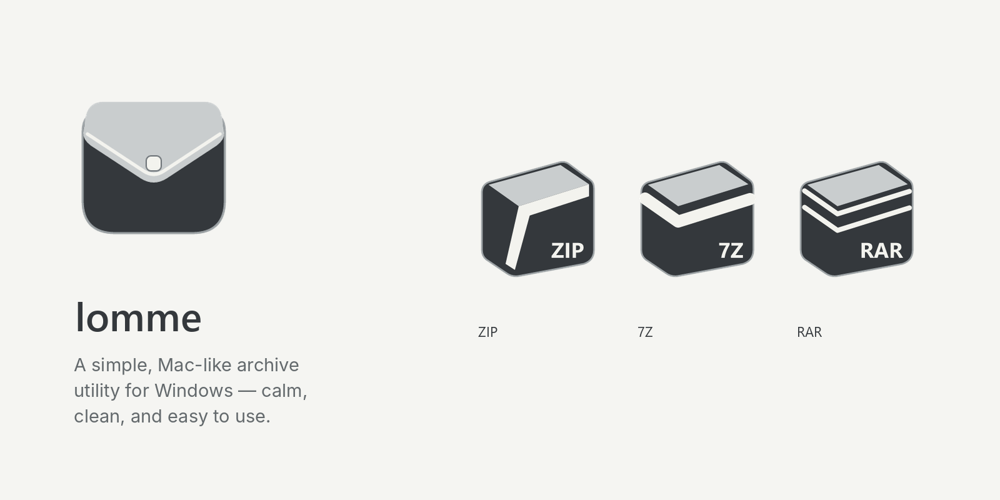
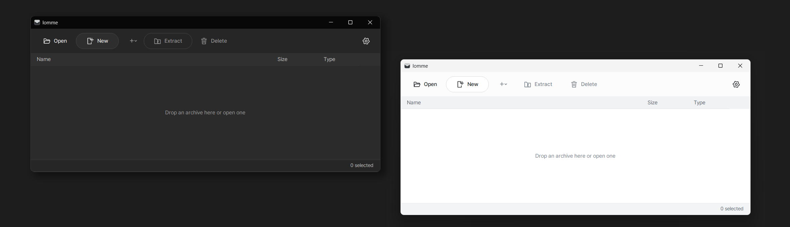
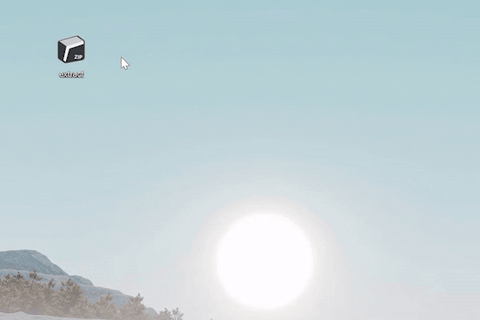
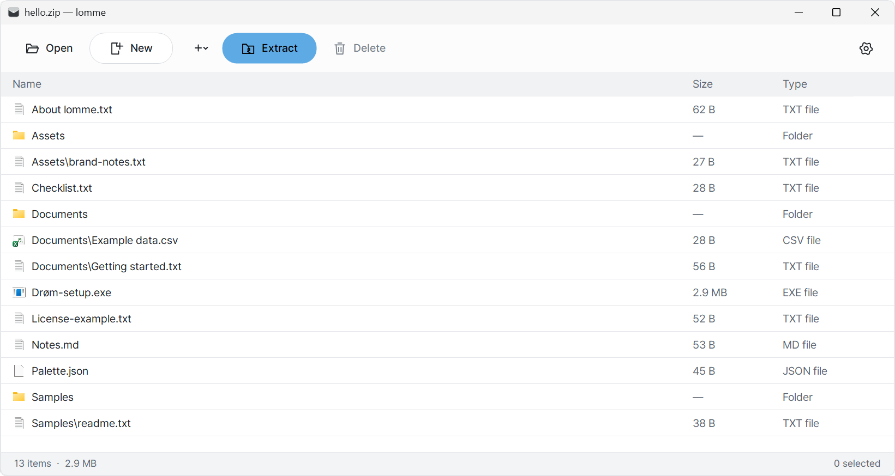
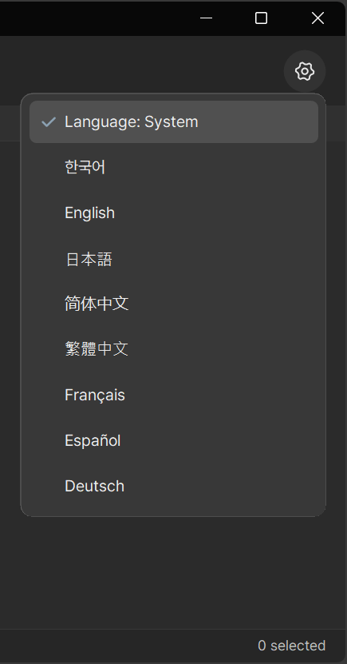
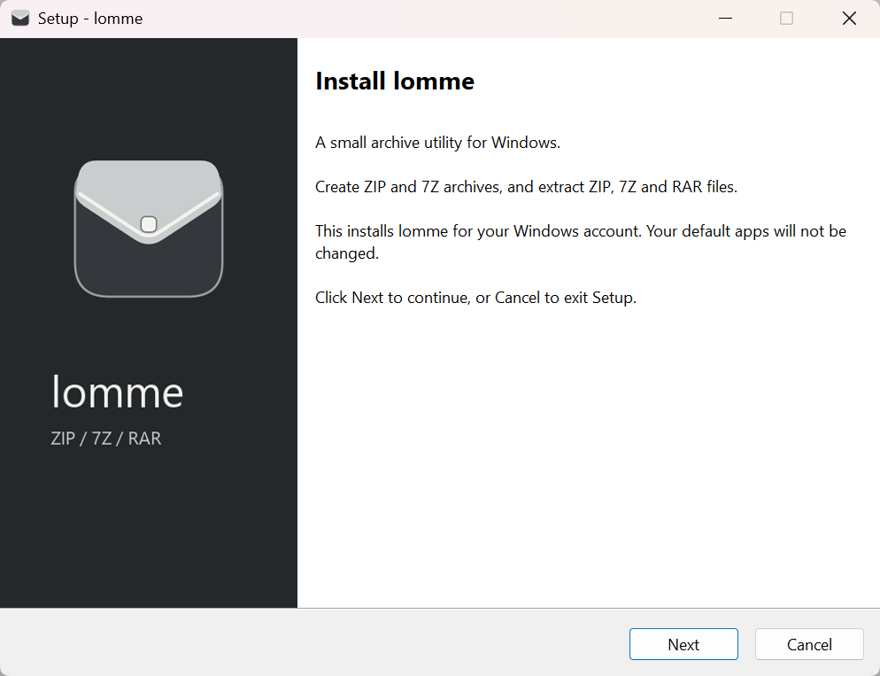

 

[**Download v1.0.0**](https://github.com/so1fr1d/lomme/releases/tag/v1.0.0) · [Features](#features) · [Installation](#installation)

## Meet lomme

A small, Mac-like archive utility for Windows — calm, clean, and easy to use. Create ZIP and 7Z archives, extract ZIP, 7Z and RAR files, and work with their contents as naturally as you would in File Explorer.

  

| Format | Create | Extract |
| :--- | :---: | :---: |
| **ZIP** | ✓ | ✓ |
| **7Z** | ✓ | ✓ |
| **RAR** | — | ✓ |

## In action

Double-click a supported archive when lomme is its default app to extract it right away.

  

*For smaller archives, extraction may finish so quickly that the progress window never appears.*

To look inside an archive instead, select **Open with lomme** from File Explorer's context menu.

## Features

lomme works with archives much like File Explorer: browse folders, drag files in or out, double-click to open, and add or remove items in supported formats.

- **Quick extract:** double-click an associated archive to extract it without bringing the main app to the foreground. Small archives may finish before a progress window appears.
- **Password protection:** create encrypted archives; 7Z supports Unicode passwords and file-name encryption, while ZIP creation uses ASCII passwords for compatibility.
- **ESC shortcuts:** close an idle window or dismiss a dialog with ESC, while active operations are protected from accidental closing.

Light and dark themes, eight interface languages, and File Explorer integration are included.

### Explore an archive

  

### Eight languages

  

## Installation

**Version 1.0.0 is available now.** Download `lomme-setup-1.0.0.exe` from the [v1.0.0 release](https://github.com/so1fr1d/lomme/releases/tag/v1.0.0).

The installer supports eight languages and installs for the current Windows account. It doesn't automatically change your default apps: to associate `.zip`, `.7z`, and `.rar` with lomme, visit **Windows Settings → Apps → Default apps**.

  

### File Explorer commands

- **Open with lomme** — browse archive contents.
- **Extract here** — extract alongside the archive.
- **Compress with lomme** — create ZIP or 7Z archives from files and folders.

On Windows 11, these commands appear under **Show more options**.

## Notes

- **RAR extraction only:** creating or modifying RAR archives is not supported.
- Use ASCII passwords when creating ZIP archives. 7Z supports Unicode passwords.
- Files opened temporarily from an archive are not automatically written back if edited.
- **Windows 11 x64** is the tested platform. Windows 10 is not verified.
- The public installer is **unsigned**. Verify its SHA-256 checksum against `SHA256SUMS.txt` in the release; keep Windows security protection enabled.
- The 1.0 installer is **not** an automatic in-place upgrade for older lomme 0.4.x installations.

## Uninstall

Remove lomme via **Windows Settings → Apps → Installed apps**. App-specific settings are deleted on uninstall, while your personal archive files are preserved. Uninstall remains available even if lomme is your default archive app.

## Credits & licenses

Made by **so1fr1d**.

lomme is free for personal and commercial use under its [freeware license](LICENSE.txt); the proprietary installer may not be redistributed without permission. Third-party rights remain separate. See [third-party notices](THIRD-PARTY-NOTICES.txt) and the source/license archives included with the release.
